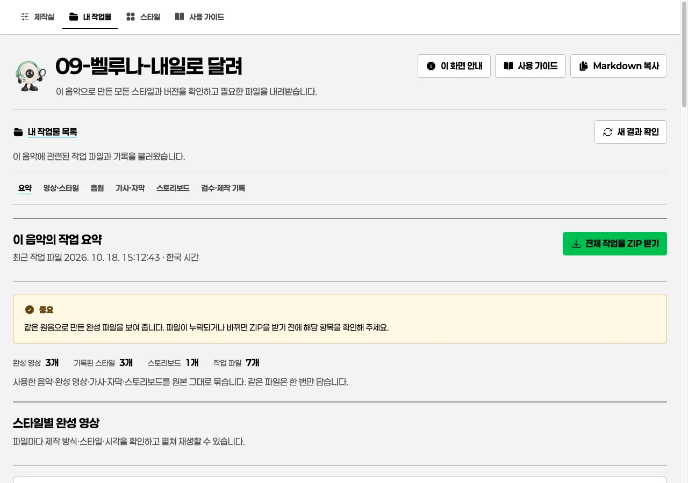

# 완성 결과: 현재 프로젝트 호환 보기

## 이 페이지의 역할

`/results/`는 현재 열어 둔 프로젝트의 완성 파일을 바로 확인하는 **호환 경로**입니다. 전역 메뉴에는 표시하지 않습니다. 제작이 끝난 모든 곡·버전·검수 기록을 찾아볼 때는 [내 작업물](works.md)에서 시작하세요. 제작 설정, 스타일 선택, 피드백 입력은 다른 페이지에서 합니다.

이 경로에서도 기본 화면은 여러 결과를 빠르게 비교하는 **목록 보기**이며, 필요할 때만 한 항목을 넓게 보는 **크게 보기**로 전환합니다.



> [!NOTE]
> 이미지는 권장 진입점인 **내 작업물 상세**의 화면입니다. 호환 `/results/`의 배치와는 다릅니다. 표시된 곡명·영상·파일 수는 현재 프로젝트의 완료 상태를 뜻하지 않으며, 실제 등록 파일 목록과 원음 상태를 확인해야 합니다.

## 목록 보기와 크게 보기

### 목록 보기

파일 형식, 이름, 크기, 원음 상태를 한 번에 비교할 때 사용합니다. 여러 수정본이 있으면 같은 종류의 파일을 목록에서 차례로 재생하거나 내려받을 수 있습니다.

### 크게 보기

한 영상을 길게 재생하거나 긴 원가사를 읽을 때 사용합니다. 크게 보기는 파일을 새로 만들거나 현재 곡의 결과로 바꾸지 않습니다. 목록으로 돌아가면 다른 결과도 다시 비교할 수 있습니다.

## 결과 파일의 의미

### 완성 음원

프로젝트에 `audio`로 등록한 완성 음원입니다. 제작에 사용한 **입력 음원**은 여기에 자동으로 나타나지 않습니다.

> [!NOTE]
> 이 호환 화면에는 현재 프로젝트에 등록한 파일만 보입니다. 입력 음원·스타일 샘플·중간 미리보기는 완성 결과로 자동 승격되지 않습니다.

### 원가사

프로젝트에 `lyrics`로 등록한 UTF-8 텍스트 또는 Markdown 원문입니다. 화면에는 안전한 일반 텍스트로 보이고, 원본 파일은 **가사 다운로드**로 받을 수 있습니다. 원가사를 음성 인식 결과로 임의 교체하지 않습니다.

### 자막

SRT, VTT, ASS, LRC 같은 파일을 `captions`로 등록한 경우에만 표시됩니다. 자막이 없으면 "자막 없음" 상태를 안내하며, 가사가 있다는 이유만으로 SRT가 만들어졌다고 표시하지 않습니다.

### 완성 영상

프로젝트에 `video`로 등록한 MP4, MOV, WebM 결과입니다. 재생과 **영상 다운로드**를 제공합니다. 샘플 영상이나 중간 미리보기는 이 목록에 포함되지 않습니다.

### 스토리보드

`storyboard`로 등록한 이미지는 [결과 검수](review.md)와 [내 작업물 상세](works.md)에서 확인합니다. 음악별 그룹 ZIP에는 원음과 함께 포함되지만, 현재 프로젝트의 호환 다운로드는 표시된 결과만 따릅니다.

## 다운로드 원칙

개별 다운로드는 현재 목록에 등록된 파일만 제공합니다. 음악별 보관함의 **음악 그룹 ZIP**은 사용한 원음, 등록된 완성 영상·완성 음원·원가사·자막·스토리보드를 담습니다. 입력 음원 외의 다른 곡 샘플, 스타일 예시, 중간 렌더, 새로 생성되지 않은 항목은 넣지 않습니다.

자막이나 원가사가 등록되지 않았다면 묶음에도 포함되지 않습니다. 목록에서 파일을 먼저 확인한 뒤 필요한 파일을 다시 등록해야 합니다.

## 원음 상태 확인

각 결과는 제작에 사용한 원음 기록을 현재 프로젝트 원음과 비교합니다.

- **현재 원음과 일치**: 현재 곡에 사용할 수 있는 결과입니다.
- **다른 원음의 결과**: 이전 곡·수정 전 원음의 결과일 수 있습니다. 현재 곡의 완성본처럼 내려받거나 납품하지 마세요.
- **원음 확인 필요**: 비교 근거가 없습니다. 결과를 검수한 뒤 제작 기록을 확인하세요.

## 새 결과를 보려면

제작이 끝난 뒤 결과를 등록하고 페이지에서 **새 결과 확인**을 누릅니다. 자동으로 목록을 새로 고치지 않으므로, 재생 중인 영상이나 작성 중인 검수 의견이 예고 없이 바뀌지 않습니다. 새 등록은 [내 작업물](works.md)에도 누적되어 같은 원음의 이전 결과와 비교할 수 있습니다.

## 결과 확인을 요청하는 예시

```prompt
현재 프로젝트에 등록된 완성 파일만 목록으로 확인해 주세요.
완성 음원, 원가사, 자막, 영상, 스토리보드를 구분하고 입력 음원이나 스타일 샘플은 완료본으로 표시하지 말아 주세요.
원음 상태가 다른 파일은 현재 곡의 완료본으로 승인하지 말고 검수 기록에 이유를 남겨 주세요.
```

## 자주 묻는 질문

### 목록에 영상이 없어요

영상이 아직 제작되지 않았거나 결과 manifest에 `video`로 등록되지 않았습니다. 스타일 샘플과 입력 음원은 완성 결과로 승격되지 않습니다.

### SRT만 따로 내려받을 수 있나요

등록되어 있다면 가능합니다. 자막 항목의 다운로드를 사용하세요. 등록되지 않은 SRT를 화면이 자동 생성하지는 않습니다.

### ZIP에 왜 입력 음원이 없나요

현재 프로젝트의 호환 다운로드는 표시된 결과만 따릅니다. 반면 내 작업물의 음악 그룹 ZIP에는 해당 그룹을 구분하는 **사용한 원음**을 한 번만 포함합니다. 입력 음원을 완성 음원으로 표시하지는 않습니다.

## 다음으로 읽기

[내 작업물](works.md) · [결과 검수와 승인](review.md) · [원음 상태와 등록 방법](cli.md)
