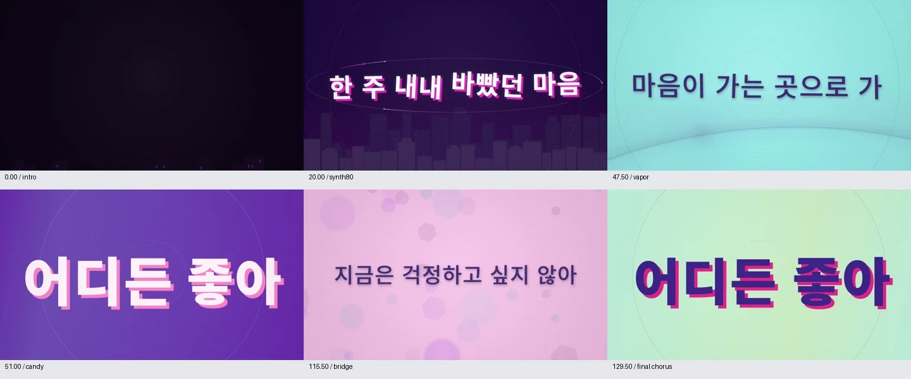
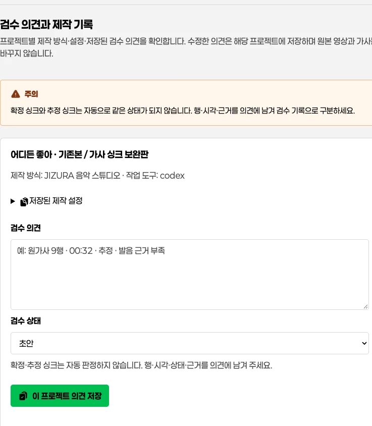

# 결과 검수: 스토리보드·가사·승인

## 이 페이지의 역할

`/review/`는 현재 프로젝트를 바로 확인하는 **호환 경로**입니다. 전역 메뉴에는 표시하지 않습니다. **내 작업물** 상세의 검수·제작 기록에서는 프로젝트별 피드백과 상태를 계속 확인할 수 있습니다. 이 화면은 실제로 등록된 파일을 근거로 의견을 기록하며, 결과 자체를 바꾸는 편집기는 아닙니다.

## 검수 순서

1. 현재 원음과 결과의 원음 상태를 확인합니다.
2. 완성 영상을 재생하고 중요한 구간을 스토리보드와 대조합니다.
3. 원가사와 자막을 나란히 확인합니다.
4. 제작 단계의 가사 검수 기록에서 확정·추정 시각과 근거를 확인합니다. 화면이 행별 상태를 자동 판단하지는 않습니다.
5. 수정할 내용은 피드백에 구체적으로 적고 상태를 저장합니다.
6. 문제가 없으면 승인으로 바꾸고 **검수 마치기**를 누릅니다.


도식은 검수 순서를 설명하는 예시입니다. 화면이 행별 상태를 자동으로 결정하지 않으므로, 실제 원음·원가사·자막을 대조한 근거만 기록합니다.



> [!NOTE]
> 스토리보드는 실제 등록된 장면 이미지로 대조합니다. 예시 화면의 곡명·시각·장면은 현재 프로젝트의 결과가 아닙니다.

## 원가사와 자막의 차이

원가사는 승인된 가사 원문입니다. 자막은 영상 화면에 맞춘 시간 정보가 있는 별도 파일입니다. 두 파일이 다르게 보일 때 원가사를 자동으로 음성 인식 결과로 바꾸지 않습니다. 오인식, 의도된 반복, 노래의 발음 차이는 피드백에 남기고 원문 유지 여부를 먼저 판단합니다.

## 확정 싱크와 추정 싱크

- **확정 싱크**: 원음·가사·검수 근거를 통해 확인한 시각입니다.
- **추정 싱크**: 자동 정렬, 반복 구간, 불명확한 발음 때문에 시각을 추정한 항목입니다.

이 공통 페이지는 원가사와 자막 파일을 보여주며 **행별 확정·추정을 자동 판정하거나 라벨로 표시하지 않습니다**. JIZURA 제작 단계의 가독성·싱크 검수 기록을 함께 확인하고, 피드백에 `원가사 9행 · 00:32.10 · 추정 · 발음 근거 부족`처럼 행·시각·확정/추정·사유를 기록하세요. 확정할 수 없는 항목은 추정 상태로 남깁니다. 등록된 `syncChecks`가 있으면 영상·자막·가사 SHA와 실제 프레임 검수 근거는 제작자료 ZIP에서 읽습니다. 자세한 자동 검수와 기록 관리 절차는 [JIZURA 설정 가이드](jizura.md)를 참고하세요.

> [!IMPORTANT]
> 추정 싱크는 확정 싱크와 분리해 남깁니다. 원음·원가사·자막의 근거가 모이기 전에는 추정을 확정으로 바꾸지 않습니다.

## 피드백을 잘 쓰는 법

피드백에는 장면 또는 시간, 문제, 원하는 수정 순서로 적습니다.

`01:12 후렴 첫 줄 — 글자가 배경과 겹쳐 읽기 어렵습니다. 흰색 외곽선과 2줄 줄바꿈으로 수정해 주세요.`

막연한 "더 화려하게"보다 구간과 목적을 적으면 다음 제작 단계가 정확해집니다. 저장은 제작 요청이 아니라 검수 기록입니다.

## 상태의 뜻

- **초안**: 아직 전체를 확인하지 않았습니다.
- **수정 요청**: 수정할 항목을 기록했습니다. 실제 수정·재렌더는 별도 제작 단계입니다.
- **승인**: 현재 등록 결과를 검수 기준으로 승인했습니다. 외부 게시를 뜻하지 않습니다.

> [!NOTE]
> 피드백과 승인 상태는 현재 프로젝트의 검수 기록입니다. 저장해도 영상 수정·재렌더·외부 게시가 자동으로 시작되지는 않습니다.



1. **검수·제작 기록** 메뉴에서 프로젝트별 상태와 저장된 의견을 확인합니다.
2. 수정할 내용은 현재 프로젝트에만 저장하고, 다른 음악이나 다른 버전의 기록을 덮어쓰지 않습니다.
3. 승인 상태는 외부 게시나 재렌더 시작이 아니라 현재 등록 결과의 검수 판단입니다.

## 복사해 쓸 검수 요청 예시

```prompt
이 전곡 영상을 원가사와 함께 재생하며 검수해 주세요.
가사 잘림, 줄바꿈, 잔상, 배경 대비, 비트보다 앞서거나 늦는 전환을 구간별로 확인해 주세요.
확정된 싱크와 추정 싱크를 구분하고, 확정할 수 없는 행은 원문을 바꾸지 않은 채 행 번호·시각·사유를 검수 기록에 남겨 주세요.
수정이 필요하면 문제 구간, 원인, 권장 수정 순서까지 기록해 주세요.
```

## 피드백 기록 예시

아래 시각과 문장은 **기록 형식 예시**입니다. 실제 검수에서는 현재 영상의 시각과 원가사 행 번호를 씁니다.

```text
02:14.20 · 원가사 12행 · 추정
후렴 반복으로 가창 시작점이 불명확합니다. 원문은 유지하고 다음 재생 검수 전까지 추정으로 둡니다.

02:36.08 · 원가사 18행 · 확정
원음 재생과 자막 시작점이 일치합니다. 배경이 밝아 글자 외곽선만 추가 요청합니다.
```

## 오류와 복구

### 새 결과가 바로 안 보여요

결과 등록 뒤 **새 결과 확인**을 누릅니다. 열린 검수 화면은 자동 갱신하지 않으므로 재생 중인 파일과 작성 중인 의견을 보호합니다.

### 가사 또는 SRT가 없어요

등록되지 않은 파일은 검수 완료로 가정하지 않습니다. 원가사가 없으면 원문을 등록하고, 자막이 필요하지만 없다면 제작 단계에서 SRT를 만들어 등록해야 합니다.

### 이전 곡의 결과가 보여요

원음 상태가 **다른 원음의 결과**인지 확인합니다. 결과를 현재 프로젝트의 완료본으로 승인하지 말고, 현재 원음으로 만든 결과를 다시 등록하세요.

## 자주 묻는 질문

### 검수 마치기를 누르면 수정이 시작되나요

아닙니다. 현재 의견과 상태를 먼저 저장한 뒤 검수 세션의 완료 신호를 남깁니다. 저장에 실패하면 종료하지 않습니다. 수정 요청이 있다면 해당 제작 스킬이 피드백을 읽어 다음 작업을 진행합니다.

### 추정 싱크를 승인할 수 있나요

가능하지만 추정이라는 기록은 남겨야 합니다. 근거가 더 생기면 확정 시각으로 갱신해 다시 검수하세요.

## 다음으로 읽기

[내 작업물 상세](works.md) · [제작실에서 수정 방향 저장](studio.md) · [문제 해결](troubleshooting.md)
