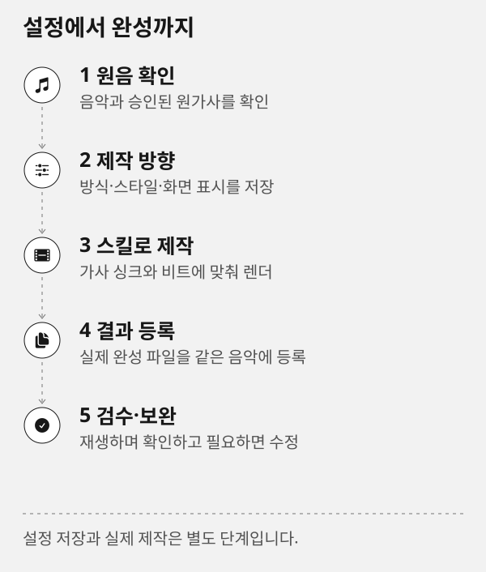
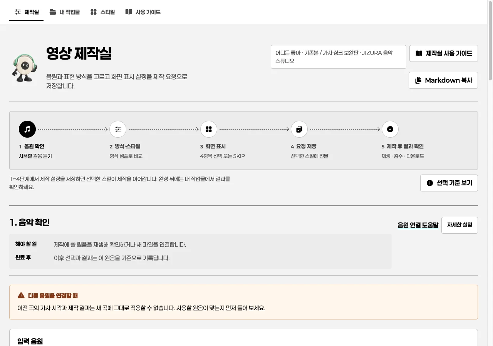

# Road Music 영상 제작실 사용 가이드

## 이 가이드의 역할

Road Music은 음악을 만든 뒤 영상 제작 방향을 정하고, 완성 파일을 따로 확인하는 작업 공간입니다. 화면에서 선택을 저장하는 일과 실제 영상 제작은 구분합니다. **선택·제작 요청 저장**은 다음 스킬이 읽을 제작 요청을 남기며, 그 자체로 렌더를 시작하거나 완료하지 않습니다.

> [!IMPORTANT]
> **선택·제작 요청 저장**은 영상·음원 생성이나 렌더 완료가 아닙니다. 완성 파일이 등록된 뒤에만 내 작업물에서 재생과 다운로드가 가능합니다.

## 한 번에 보는 작업 흐름



이 도식은 기능의 순서를 보여 주는 예시입니다. 화면의 예시 곡명·파일 수·설정값은 현재 곡의 결과가 아닙니다. 실제 작업에서는 먼저 원음을 확인하고, 설정을 저장한 뒤에 선택한 제작 스킬이 영상을 만들며, 완료 파일을 등록한 후에만 내 작업물에 나타납니다.

1. **제작실**에서 현재 원음과 원가사를 먼저 확인합니다.
2. 제작 방식과 스타일을 고르고 화면 표시 네 항목을 정합니다.
3. **선택·제작 요청 저장**으로 다음 제작 단계에 전달합니다.
4. 실제 완성 파일을 등록하고 **내 작업물**에서 같은 원음의 결과를 확인합니다.
5. 가사·효과·스토리보드를 검수한 뒤 상태와 수정 요청을 기록합니다.



> [!NOTE]
> 이 화면은 제작실의 배치 예시입니다. 카드 영상은 형식 샘플이고, 현재 곡의 완성 영상이 아닙니다. 원음 이름과 현재 선택 상태를 먼저 확인한 다음 저장하세요.

## 먼저 할 일

1. 상단 메뉴에서 **제작실**을 열고 현재 원음과 원가사를 확인합니다.
2. 제작 방식과 스타일을 함께 비교합니다. 샘플은 형식 예시일 뿐 현재 곡 결과가 아닙니다.
3. 화면 표시 네 항목을 고르거나 SKIP으로 남깁니다.
4. **선택·제작 요청 저장**을 누릅니다.
5. 담당 스킬이 실제 제작을 끝내면 **내 작업물**에서 음악별 결과를 재생·다운로드하고 검수 기록을 확인합니다.

## 상단 메뉴

- **제작실**: 원음, 제작 방식, 스타일과 화면 표시를 정합니다.
- **내 작업물**: 음악별 보관함입니다. 모든 완성 결과·가사·자막·스토리보드·검수 기록은 여기서 확인합니다.
- **스타일**: 실제 샘플로 제작 방식과 등록 프리셋의 분위기를 비교합니다.
- **사용 가이드**: 지금 열어 둔 화면의 방법과 한계를 설명합니다.

메뉴를 오가도 작성 중인 선택과 피드백은 보존합니다. 같은 화면을 다시 열 때는 이미 열린 제작실 탭을 사용하므로 새 창이 반복해서 생기지 않습니다.

`/results/`와 `/review/`는 현재 프로젝트를 바로 확인해야 하는 기존 호환 경로입니다. 전역 메뉴에는 넣지 않으며, 일상적인 결과 확인은 **내 작업물**에서 시작합니다.

## 원음과 샘플을 구분하는 법

**현재 원음**은 이 프로젝트에서 제작에 사용하는 음악입니다. 파일 이름과 원음 상태를 확인한 뒤 선택을 진행합니다. **샘플**은 다른 곡으로 만든 형식 예시이므로 현재 곡의 제작 완료본이 아닙니다. 샘플이 마음에 들어도 실제 제작은 선택 저장 뒤 해당 스킬이 이어서 수행합니다.

## 원음 상태

- **현재 원음과 일치**: 등록한 결과가 현재 프로젝트의 원음과 일치합니다.
- **다른 원음의 결과**: 다른 곡이나 이전 버전으로 만든 결과입니다. 참고용으로 보되 현재 곡의 완료본으로 판단하지 않습니다.
- **원음 확인 필요**: 원음 대조 기록이 없습니다. 재생은 가능하지만 제작 근거를 확인해야 합니다.

## 복사해 쓸 제작 요청 예시

아래는 예시 곡 **‘새벽의 온도’**를 의뢰하는 문장입니다. 실제 요청에서는 곡명과 원하는 게시 비율만 바꿔 쓰고, 원가사가 있다면 원문 파일을 함께 지정하세요.

```prompt
이 음악으로 가사와 리듬에 맞는 모션그래픽 영상을 제작해 주세요.
제작 방식 후보를 2~3개 제안하고, 각 후보의 어울리는 이유와 단일 스타일/구간별 조합 여부를 설명해 주세요.
원가사가 있으면 원문은 바꾸지 말고, 가사 싱크는 확정 근거와 추정 근거를 구분해 기록해 주세요.
완성 뒤에는 영상, 완성 음원, 원가사, 자막, 스토리보드, 검수 기록을 같은 음악 그룹에 등록해 주세요.
```

## 예시를 복사해서 사용하는 법

- **프롬프트 복사**: AI에게 요청할 문장만 복사합니다. 사용할 음악·원가사 파일과 함께 채팅에 붙여 넣으세요.
- **명령 복사**: 터미널용 명령만 복사합니다. `/absolute/...` 경로와 예시 변수는 실제 값으로 바꾸고, 바로 앞의 실행 조건을 확인하세요. 복사 버튼은 명령을 실행하지 않습니다.
- **JSON 예시 복사**: 결과 등록 파일 같은 설정 예시를 복사합니다. 설명에 지정한 UTF-8 파일로 저장한 뒤 사용합니다.
- **마크다운 복사**: 상단 버튼으로 문서 원문 전체를 복사합니다. 예시 이미지 경로는 별도 파일을 가리키므로 이미지 자체가 클립보드에 포함되지는 않습니다.
- **SVG 도식 원본 보기**: 도식 아래의 **SVG 도식 원본 보기**를 누르면 확대 가능한 원본을 확인합니다. 도식은 설명용이며 설정·제작을 실행하지 않습니다.

복사가 차단되면 같은 위치에 나타나는 텍스트 상자에서 ⌘C 또는 Ctrl+C로 복사합니다. 작은 화면에서는 이미지 아래의 **원본 크기로 펼치기**를 눌러 이미지 영역 안에서 가로·세로로 이동해 보세요.

> [!TIP]
> `prompt` 예시는 AI에게 보내는 요청이고 `bash`·`json` 예시는 사용자가 확인한 값을 넣어 실행하거나 저장하는 예시입니다. 복사 버튼 자체는 제작 명령을 실행하지 않습니다.

## 자주 묻는 질문

### 선택을 저장했는데 영상이 없어요

정상입니다. 선택 저장은 제작 요청을 기록하는 단계입니다. 이어지는 Showreel, JIZURA 또는 MV 스킬이 실제 제작을 마치고 결과를 등록해야 내 작업물에 영상이 나타납니다.

### 가사나 자막이 보이지 않아요

원가사와 자막은 별도 파일입니다. 프로젝트에 등록된 원가사가 없으면 원가사 영역은 비어 있고, SRT 같은 자막이 없으면 자막은 생성 완료로 표시되지 않습니다. [완성 결과 보기](results.md)에서 등록 상태를 확인하세요.

### Markdown 원문을 복사하려면 어떻게 하나요

가이드 상단의 **Markdown 복사**를 누릅니다. 브라우저가 클립보드 권한을 막으면 같은 페이지에 나타나는 원문 상자에서 내용을 직접 복사할 수 있습니다.

## 다음으로 읽기

[작업 흐름](workflow.md) · [작업별 안내](topics.md) · [제작실에서 선택 저장하기](studio.md) · [내 작업물 보기와 다운로드](works.md) · [결과 검수와 승인](review.md)
