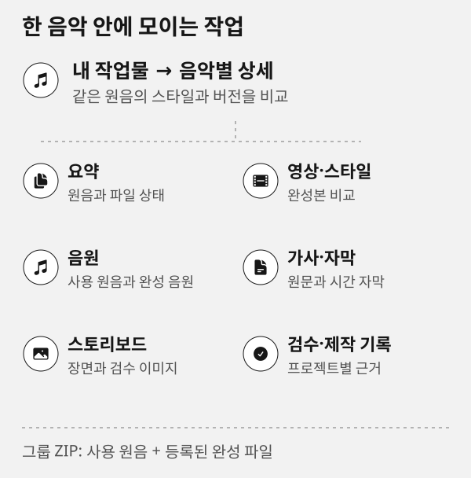

# 저장공간 관리

**저장공간 관리**는 제작한 음악별로 사용량과 연결된 영상 프로젝트를 모아 관리합니다. 기본 목록에는 음악 이름을 표시하고, 프로젝트 버전·파일·정책은 음악을 펼쳐 확인합니다. 일반 캐시 정리는 원음·완성 파일·입력·승인 자산을 보호합니다. AI M/V 전체 정리는 명시 선택한 프로젝트의 애니매틱과 영상 완성본까지 포함하는 별도 기능입니다.



> [!IMPORTANT]
> 제작 중인 프로젝트는 기본적으로 `editing` 상태이며 히스토리를 보존합니다. 완료된 작업만 재생성 가능한 캐시를 보관 기간 뒤 자동 정리할 수 있습니다.

## 통합 저장공간 상태

화면은 먼저 현재 설치와 작업 폴더에서 **실제로 검사할 수 있는 항목**을 확인합니다. 작업 폴더 스캔, 이전 제작 자료, 검증 복제본, 과거 참조 자료, Git은 각각 활성 여부와 이유를 표시합니다. 없는 Git 저장소나 개발 자료는 오류나 빈 정리 후보로 바꾸지 않고 비활성 사유만 보여 줍니다.

기본 새로 고침은 Git 객체를 깊게 검사하거나 전체 작업 폴더를 매번 다시 읽지 않습니다. Git 점검은 개발 저장소에서 별도로 선택했을 때만 실행합니다. 저장공간 이력의 SQLite와 압축 스캔 목록은 이전 결과를 재사용하는 메타데이터이며, 상태 확인만으로 전체 해시·재스캔·`VACUUM`을 실행하지 않습니다.

## SQLite 소유권 추적과 미연결 자료

Road Music은 파일을 모두 데이터베이스에 넣지 않습니다. 프로필 데이터 폴더의 `storage.sqlite3`에는 음악·프로젝트·경로의 소유권, 크기·수정 시각, 생성·수정·게시·정리의 최소 이력만 기록합니다. 작업 폴더 `.roadmusic/history.sqlite3`는 완성본의 버전과 diff 원장입니다. 실제 음원·영상·원가사·엔진 JSON·이미지와 프레임은 파일로 유지하므로 DB가 미디어를 복제해 용량을 늘리지 않습니다.

`저장공간 검사 항목`에서 먼저 활성 상태와 비활성 이유를 확인하세요. 활성 항목만 점검·최적화 대상으로 사용합니다. Git이 없는 설치에서는 Git 항목이 비활성화되고, 설치되지 않은 도구의 관리는 표시만 하며 실행하지 않습니다. 관리 항목의 이름·도움말에는 무엇을 검사하는지, 왜 비활성인지, 무엇이 보호되는지가 표시됩니다. 자세한 용어와 제거 범위는 [소유권·SQLite 상세 안내](storage-tracking.md)를 참고하세요.

`소유권 추적 새로 고침`은 필요할 때만 작업 폴더의 경로·크기·수정 시각을 SQLite 색인에 갱신합니다. 일반 새로 고침은 저장된 색인을 사용합니다. `.roadmusic`, `.harness`, `.omx`, `_workspace` 같은 관리·검수·실행 영역은 음악과 연결되지 않아도 **보호된 관리 영역**으로 표시하며 미연결 제작물로 취급하지 않습니다. 실제로 용도를 확인하지 못한 폴더도 숨기거나 자동 삭제하지 않고 **소유권 미확인·보호**로 남깁니다.

```text
상태: 활성 검사만 실행 가능
관리 영역: 도구가 쓰는 보호된 자료, 자동 정리 대상 아님
소유권 미확인: 화면에는 보이지만 원인 확인 전 삭제 대상 아님
등록 cache: 완료 뒤 정책·예산에 따라 재생성 가능 자료만 정리 후보
```

## 음악별 목록과 자동 일괄 정리

같은 원음 해시의 제작 버전은 한 음악으로 묶입니다. 음악을 펼쳐 각 작업과 AI M/V 사용량을 확인하세요. 테스트용 `desk`, `project-refined`, 설치 검증처럼 음악으로 연결되지 않은 자료는 기본 목록에 섞지 않으며 **기타 정리 대상·고급 관리**에서 펼쳐 볼 수 있습니다.

우측 상단 **자동 일괄 정리**를 누르면 작업 폴더 전체를 먼저 스캔하고, 검증된 캐시·과거 잔재의 목록과 예상량을 보여 줍니다. 확인 실행 후 실제 확보 용량과 건너뛴 항목을 확인하세요. 일반 일괄 정리가 음악 원본이나 영상 완성본을 자동으로 삭제하지는 않습니다.

저장공간 화면의 위쪽 막대는 **디스크 전체**의 사용·남은 공간이고, 아래 막대는 **Road Music 작업 폴더**의 음악 그룹·모델·프로그램·테스트 입력·보호된 관리 영역·소유권 미확인 자료를 따로 분류한 값입니다. 두 막대의 분모가 다르므로 수치를 합쳐 해석하지 않습니다. 음악을 펼치면 해당 음악에 연결한 제작 폴더와 모션그래픽 자료, 등록 캐시와 미등록 자료를 같은 곳에서 확인합니다.

음악을 펼친 **등록된 원음·완성 파일**에서는 파일명·종류·용량·검증 상태를 확인하고 음원·영상은 직접 재생하거나 내려받을 수 있습니다. 개별 정리는 파일의 원음·현재 참조·완성본 보호 상태를 다시 검사한 계획에서만 가능하며, 보호된 파일은 이유만 표시합니다. 임의 경로나 제작 폴더의 파일을 이 목록에서 직접 열거나 지우지 않습니다.

완성 후 더 이상 수정하지 않을 private 작업 프로젝트는 **완성 후 작업 자료 정리**로 확인할 수 있습니다. 완료·보관 상태, 활성 작업과 핀, canonical Output과 최소 이력을 모두 확인한 뒤에만 `.roadmusic/work`의 작업 자료를 정리합니다. 최종 납품과 원음은 이 정리에 포함되지 않습니다. 입력 음원과 완성 음원이 같으면 실제 파일은 한 번만 보관하고 두 역할이 같은 파일을 참조합니다. SQLite의 누적 출력 용량은 제작 당시 기록이며 현재 디스크 사용량과 다릅니다. 현재 남은 용량은 이 저장공간 화면에서 확인하세요.

## 완성본 전용 Output과 버전 기록

완료된 납품만 `Output/<음악--원음SHA12>/<프로젝트--ID12>/<YYYYMMDD-HHMMSS>/`에 둡니다. 이 폴더에는 검증된 음원·영상·가사·자막·최종 스토리보드만 있으며, 캐시·렌더 조각·실행 환경·작업 JSON은 들어가지 않습니다. 제작 중 입력·재개 자료와 재생성 캐시는 `.roadmusic/work/`에 분리합니다.

같은 음악을 다시 보완해 게시하면 음악 상세의 **버전·변경 내역**에서 초 단위 시각, 기록된 수정 사유, 파일 추가·삭제·변경과 텍스트·설정 diff를 확인합니다. 프로필 SQLite의 최소 이벤트는 제작·음원·가사·제목·모션그래픽 변경과 게시·정리 시각을 연결하고, `.roadmusic/history.sqlite3`은 납품 버전·diff를 보관합니다. 두 DB 모두 메타데이터만 저장하므로 미디어 파일을 중복 보관하지 않습니다. 수정 사유가 기록되지 않은 과거 결과는 추측하지 않고 **수정 사유 미기록**으로 표시합니다.

> [!IMPORTANT]
> Output은 편집 장소가 아닙니다. 같은 내용의 재게시로 새 버전을 늘리지 않고, 검증에 실패한 중간 출력은 Output에 넣지 않습니다.

## AI M/V 프로젝트 통째 정리

음악 그룹에서 AI M/V 전체 정리를 선택하면 해당 곡의 선택한 제작 버전, 애니매틱 master, 최종 영상, 샷 출력, 키시트·스토리보드·검수 자료와 중간본이 삭제 계획에 포함됩니다. 화면에 표시된 프로젝트와 포함 범위를 확인한 뒤 실행하세요. 외부 원본 음원·가사·설치 모델·현재 프로그램은 유지하며 삭제 요약과 입력 해시는 프로젝트 밖에 남습니다.

원음이 삭제할 루트 안에 있거나 현재 제작 중·열린 파일·변경된 파일이 있으면 차단될 수 있습니다. 다른 음악의 쇼릴이나 임의 리서치 폴더를 자동으로 끌어오지 않습니다. 이 기능은 해당 M/V를 계속 수정할 필요가 없을 때 사용하세요.

## 프로젝트·음악 그룹을 제거할 때

프로젝트 또는 음악 그룹을 제거하면 먼저 대상 파일, 완성본 포함 여부, 공유 원음·활성 작업·핀한 자산의 보호 상태를 모달에서 확인합니다. 프로젝트 제거는 해당 프로젝트의 live 경로·소유권·이력을, 음악 그룹 제거는 선택 그룹의 live 프로젝트·버전 연결을 함께 정리합니다. canonical 완성 파일까지 포함할 수 있으므로 일반 캐시 정리와 같은 버튼이 아닙니다.

> [!WARNING]
> 실제 삭제가 성공한 뒤에만 해당 live 행을 `storage.sqlite3`에서 제거합니다. 다른 음악과 공유하는 원음, 외부 원음, 모델·프로그램, 활성 작업, 핀한 항목은 차단됩니다. 제거된 파일의 메타데이터는 일반 조회에서 사라지며, 납품 이력 원장과 최소 감사 기록은 제품 정책에 따라 별도로 보존될 수 있습니다.

```text
프로젝트 제거: 선택 프로젝트 범위와 그 live 추적 정보만 검토
음악 그룹 제거: 같은 원음으로 연결된 프로젝트와 완성본 포함 여부를 모두 확인
일반 캐시 정리: 재생성 가능한 cache만, 완성 파일은 포함하지 않음
```

## 무엇을 확인하나요

프로젝트마다 실제 경로와 사용량, 다음 분류를 확인합니다.

- **캐시**: 다시 만들 수 있는 `.roadmusic/cache` 파일입니다. 완료 또는 보관 상태에서 보관 기간이 지난 항목만 자동 정리 대상이 됩니다.
- **중간본·히스토리**: 기본 보존 대상입니다. 선택해 미리 본 뒤에만 정리할 수 있습니다.
- **보호 파일**: 원음·완성 manifest·입력·현재 참조 자산·핀한 항목입니다. 이유와 함께 표시되며 삭제 대상이 아닙니다.

성공한 영상 렌더 뒤에는 자동 정리가 켜져 있고 캐시 예산을 초과한 경우 producer 소유 `picture` 캐시만 정리합니다. 예산 이내 캐시·핀한 자료·실패 후 재개 파일은 유지하고 실패한 작업은 편집 중으로 돌아갑니다. 원음·영상 완성본·중간 이력은 이 예산 정리에 포함하지 않습니다.

처음 프로젝트를 만들 때부터 `.roadmusic/cache`에 재생성 가능한 캐시를 분리하세요. 캐시 관리에 등록하지 않은 파일은 보호 상태로 남습니다.

등록할 때는 분류와 같은 `.roadmusic/cache/`, `.roadmusic/intermediate/`, `.roadmusic/history/` 내부 상대 경로만 사용합니다. 기존 프로젝트의 다른 위치에 있는 레거시 파일은 자동으로 등록하거나 삭제하지 않습니다. 지원되는 제작 형식만 아래의 별도 이전 절차로 확인할 수 있습니다.

## 안전하게 정리하는 순서

1. 프로젝트와 상태를 확인합니다. 아직 편집 중이면 상태를 유지하세요. 자동 정리는 실제 완료·보관 상태에서만 실행됩니다.
2. 히스토리 보존, 자동 정리, 보관 일수와 캐시 예산을 확인합니다. 기본 예산은 2 GiB와 20,000개 파일입니다.
3. 기본값인 캐시만 선택한 뒤 **정리 미리 보기**를 누릅니다. 중간본·히스토리는 명시적으로 선택해야 합니다.
4. 파일 수, 예상 회수 공간, 보호·차단 사유를 검토합니다.
5. 확인 대화상자에서 삭제를 확정합니다. 계획을 만든 뒤 파일·정책·작업 잠금이 바뀌면 해당 항목은 건너뜁니다.

```text
편집 중: history 보존 + 자동 삭제 없음
완료됨: 보관 기간이 지난 재생성 cache만 자동 정리 가능
보관됨: 보관 기간이 지난 재생성 cache만 자동 정리 가능
```

## 현재 프로젝트와 내 작업물

이 페이지는 현재 제작실 프로젝트를 자동으로 등록합니다. CLI와 [내 작업물](works.md)에서 이미 검증해 등록한 과거 프로젝트도 목록에서 확인할 수 있습니다. 브라우저에서 임의 경로를 등록하거나 셸 명령을 실행할 수는 없습니다.

프로젝트별 선택, 정책 변경, 핀 상태는 페이지를 새로 고쳐도 서버의 실제 기록에서 다시 읽습니다. 정리와 정책 변경의 요약은 프로젝트 히스토리에 남습니다.

**패키지 검증**으로 등록된 Road Music 저장소는 관리 폴더의 용량만 집계합니다. 소스·모델·하위 음악 프로젝트를 중복 집계하지 않습니다. 이 화면의 전체 범위는 등록된 제작 프로젝트와 지원되는 저장소 검증 캐시이며 컴퓨터 전체가 아닙니다.

## 과거 렌더·검증 캐시 찾기

**후보 찾기**는 제작 기록과 실제 파일을 대조한 자료만 보여 줍니다. 기존 Showreel production·playlist, production·preset이 일치하는 CD 무음 영상, 완료·납품 해시가 검증된 과거 native 렌더 조각을 지원합니다. native의 aggregate와 납품 영상은 보존합니다.

패키지 검증 ZIP은 현재 저장소의 사전 검수된 과거 두 항목만 지원합니다. 로컬 검증 전용 기록, 체크섬과 공개 배포 기록을 대조하며 배포 ZIP·펼친 프로그램·실행 환경은 보호합니다. 이름이 package-check나 draft라는 이유로 다른 자료를 삭제하지 않습니다.

후보를 선택해 **관리 캐시로 옮기기**에서 원래 경로와 대상·용량을 확인하세요. 이전은 삭제가 아닙니다. 이전 뒤 필요한 항목은 핀으로 보존하고, 실제 삭제할 자료만 기존 **정리 미리 보기**에서 다시 확인해 정리합니다. 공용 앱 분석 캐시는 현재 실행 중인 앱이 의존할 수 있어 이 범위에 넣지 않습니다.

## 현재 앱의 과거 공용 영상 캐시

**공용 캐시 점검**은 현재 앱 프로필이 실행 중이고 유휴 상태일 때만 공개 CLI `video:cache --no-start`를 호출합니다. 이 버튼을 누르기 전에는 공용 캐시를 조회하지 않습니다. 점검 결과에서 실제 캐시 경로·파일 수·예상 확보 용량과 보호 사유를 확인한 뒤, 같은 확인 창에서만 정리할 수 있습니다.

정리는 같은 앱 프로세스에서 만든 15분 일회용 계획과 별도 확인이 필요합니다. 원음, 완성 영상, 작업 이력, 알 수 없는 파일과 symlink는 계획에 넣지 않습니다. 앱이 실행 중이지 않거나 작업 중이면 앱을 시작하거나 현재 작업이 끝난 뒤 다시 점검하세요. 프로젝트별 캐시·중간본과 이 공용 캐시는 서로 섞이지 않습니다.

## 작업 폴더 정리

**작업 폴더 정리**는 현재 신뢰할 수 있는 Road Music 소스 폴더에서만 동작합니다. 여기서는 두 종류를 따로 점검합니다.

먼저 상태에서 활성화된 검사만 선택합니다. 일반 작업 폴더 점검은 폴더·파일 수, 논리·할당 용량, 상위 폴더와 분류별 메타데이터를 보여 줍니다. 심볼릭 링크는 크기를 따라가지 않고 개수만 표시합니다. 이전 제작 자료는 해당 범위를 선택했을 때만, Git은 개발 저장소에서 Git 점검을 명시했을 때만 검사합니다. 선택한 스캔이 완료되기 전에는 해당 범위의 정리 미리보기나 삭제를 만들 수 없습니다.

- **Git 미참조 객체**: Git 저장소 capability가 활성이고 별도 Git 점검을 선택했을 때만 확인합니다. 현재 참조, reflog, 모든 worktree와 스테이징 상태를 보존한 뒤 24시간 이상 지난 미참조 객체만 후보로 표시합니다. Git 정리 중에는 다른 Git 작업을 하지 마세요.
- **과거 설치 검증 복제본**: 실제 설치 검증 기록과 대조돼 현재 프로그램·모델·결과물과 연결되지 않는 복제본만 후보로 표시합니다.

후보마다 용도, 보존 근거, 파일 수와 예상 확보량을 확인하고 한 종류씩 미리 보기를 만듭니다. Git 후보와 설치 검증 후보를 한 계획에 섞을 수 없습니다. 확인 실행 뒤에는 삭제 파일 수, 논리 정리량, 실제 할당량 변화, 디스크 여유 변화와 감사 기록 경로를 표시합니다. Git 객체의 논리 크기는 packfile 구조 때문에 실제 디스크 여유 증가와 같지 않을 수 있습니다.

**작업 폴더 정리 이력**을 펼치면 최근 실행의 시간, 대상, 제거 수와 실제 확보 용량을 다시 확인할 수 있습니다. 이력은 페이지를 다시 열어도 유지됩니다.

현재 모델·프로그램, 원음·최종 음악·영상, 승인 자산, 필요한 제작·검수 이력, 현재 Git 참조와 설치에 쓰는 검증본은 이 기능의 삭제 대상이 아닙니다. 다운로드한 예전 CLI처럼 이 기능을 지원하지 않는 설치에서는 안내만 표시하며 파일을 임의로 삭제하지 않습니다.

## 이전 구조를 완성본 전용으로 전환하기

과거 테스트·미연결 폴더가 남아 있다면 **구조 전환 점검**에서 먼저 전체 스캔을 실행합니다. 이 점검은 등록된 완성본과 원음의 해시, 현재 프로그램·모델, 활성 제작 잠금과 연결을 확인한 뒤에만 이전 제작 폴더를 정리 후보로 표시합니다. 확인 실행 전에는 파일을 옮기거나 지우지 않습니다.

전환이 끝나면 Output에는 검증된 완성본만 남고, 계속 편집할 프로젝트는 `.roadmusic/work/` 아래의 한 작업 루트만 사용합니다. 활성 작업·누락된 원본·변경된 파일은 건너뛰며 사유를 표시합니다. 결과 화면에서 실제 확보 용량과 최소 감사 이력 경로를 확인하세요.

## 문제가 생기면

- **정리할 수 없음**: 히스토리 보존 정책, 핀, 현재 작업 잠금이나 변경된 파일 때문에 보호될 수 있습니다. 편집 중의 명시적인 캐시 정리와 완료 후 자동 정리는 구분되므로 미리 보기의 사유를 확인하세요.
- **예산 초과 경고**: 캐시 예산을 넘었다는 뜻이지 자동 삭제가 완료됐다는 뜻은 아닙니다. 완료 상태와 보관 기간을 확인한 뒤 미리 보기로 대상부터 검토하세요.
- **프로젝트가 보이지 않음**: 현재 제작실 또는 내 작업물에 실제로 등록된 프로젝트만 표시합니다. 경로를 직접 입력해 추가하지 마세요.
- **공용 캐시 점검 실패**: 현재 앱 프로필이 실행 중인지 확인하세요. 이 화면은 앱을 자동으로 시작하거나 재시작하지 않으며, 공개 CLI가 지원하지 않는 설치본의 파일을 임의로 삭제하지 않습니다.

> [!NOTE]
> 발행이 성공한 뒤의 캐시 정리 실패는 결과 등록을 되돌리지 않습니다. 경고와 히스토리를 확인한 뒤 다음에 다시 미리 보기로 정리하세요.

[내 작업물](works.md) · [제작실](studio.md) · [CLI에서 결과 등록](cli.md)

## 확인창의 계획과 취소

정리 확인창에는 가장 최근에 완료된 미리보기 하나만 연결됩니다. 취소·Escape·새로고침·다른 작업 선택으로 지난 확인 계획은 무효화됩니다. 이후에는 원하는 종류의 미리보기를 다시 열어 실제 대상을 확인하세요. 응답이 늦은 이전 미리보기가 새 확인창을 바꾸지 않으며, 실행 중 중복 확인은 막습니다.
