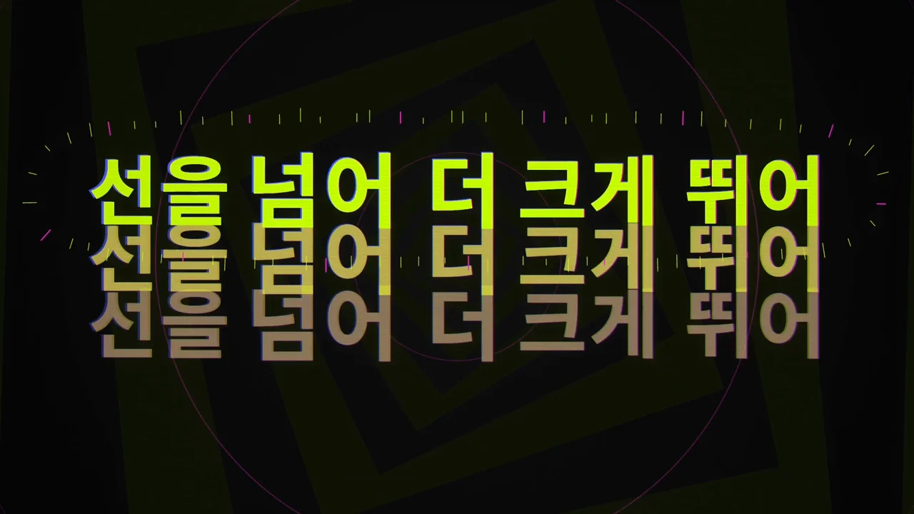
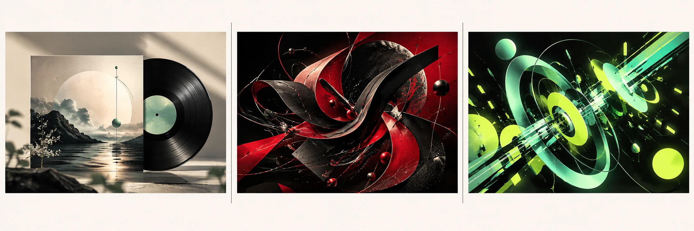
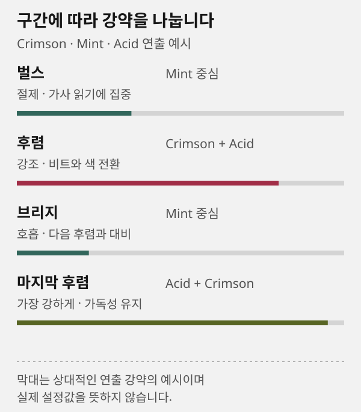

# 스타일: 목적에 맞는 화면 고르기

## 이 페이지의 역할

**스타일**은 현재 곡의 완성 결과를 고르는 곳이 아니라, 실제 형식 샘플을 보고 제작 방향을 비교하는 페이지입니다. 결과 파일과 버전별 스타일 기록은 [내 작업물](works.md)에서 봅니다.

## 먼저 정할 기준

### 음악을 오래 감상하게 할지

앨범 이미지, 회전 CD, 가벼운 스펙트럼처럼 곡을 방해하지 않는 화면이 필요하면 Showreel CD를 선택합니다. 긴 플레이리스트나 차분한 곡에 어울립니다.

### 곡의 이야기를 장면으로 풀지

가사와 감정 변화를 이미지·장면 전환으로 표현하려면 Showreel MV를 선택합니다. 인물, 배경, 소품의 일관성과 스토리보드 검수가 중요합니다.

### 비트와 가사를 화면의 주인공으로 둘지

키네틱 타이포그래피, 색 변화, 전환, 박자 반응이 중심이면 JIZURA 또는 Showreel 음악 모션그래픽이 맞습니다. 가독성과 가사 싱크를 함께 검수해야 합니다.

## 단일 스타일과 조합 스타일



이 이미지는 화면 질감과 타이포그래피를 비교하기 위한 기존 완성 프레임 예시입니다. 현재 곡의 결과나 그대로 복제할 스타일을 뜻하지 않습니다. 가사 길이와 장르, 게시 화면에 맞춰 선택합니다.

> [!NOTE]
> 형식 샘플과 콘셉트 이미지는 현재 곡의 완성 영상이 아닙니다. 선택을 저장한 뒤에도 실제 제작 단계가 결과를 만들고 등록해야 합니다.



> [!NOTE]
> 이 콘셉트 보드는 분위기 차이를 말로 비교하기 위한 가상 AI 이미지입니다. 실제 렌더, 현재 곡의 완성본, 사용 가능한 프리셋 목록이 아닙니다.

1. 곡의 가사와 장르에 맞는 분위기 방향을 고릅니다.
2. 선택한 방향이 가사 가독성과 게시 화면에 맞는지 샘플로 확인합니다.
3. 실제 제작에서는 [제작실](studio.md) 또는 [JIZURA](jizura.md)에서 구간별 강도를 정합니다.

단일 스타일은 곡 전체의 톤을 안정적으로 유지합니다. 분위기가 섬세하거나 가사가 긴 곡에는 읽기 쉬운 단일 스타일이 유리합니다.

조합 스타일은 벌스·후렴·브리지처럼 에너지 차이가 큰 곡에서 효과의 강약을 나누는 방식입니다. 예를 들어 벌스에서는 절제된 타이포그래피, 후렴에서는 색·글리치·전환을 강화할 수 있습니다. 효과가 많을수록 좋지는 않습니다. 가사 가독성, 반복되는 시각 규칙, 전환의 목적이 함께 유지되어야 합니다.



이 도식처럼 구간의 음악적 에너지에 맞춰 강도를 다르게 두되, 가사를 읽는 규칙과 기본 색 체계는 유지합니다. 한 곡에 스타일을 여러 개 쓰는 것은 가능하지만, 같은 순간에 서로 다른 강한 효과를 겹치는 방식은 피하는 편이 안전합니다.

## 추천을 받을 때 쓸 요청 예시

```prompt
이 음악의 장르, BPM 변화, 가사 분위기를 분석해 모션그래픽 스타일을 3개 추천해 주세요.
각 스타일에 단일 적용안과 벌스·후렴·브리지 조합안을 함께 제안하고, 강한 효과를 쓰는 구간과 가사 가독성을 지키는 규칙을 설명해 주세요.
추천한 스타일을 실제 완성 프레임 예시와 혼동하지 않도록, 참고용이라는 점도 표시해 주세요.
```

## 빠른 선택 예시

- **긴 가사와 잔잔한 전개**: 단일 스타일과 낮은 장식으로 시작합니다. 줄바꿈·배경 대비·싱크를 우선 확인합니다.
- **후렴과 드롭이 강한 댄스곡**: 구간별 조합으로 시작합니다. 비트 반응과 효과가 겹치는 정도를 확인합니다.
- **이야기 전개가 뚜렷한 곡**: 쇼릴 MV로 시작합니다. 장면·스토리보드·가사 의미의 연결을 확인합니다.
- **오래 듣는 플레이리스트**: Showreel CD로 시작합니다. 반복 시 피로감과 표지 가독성을 확인합니다.

## 샘플을 보는 방법

샘플을 재생할 때 다음을 확인합니다.

- 가사가 있을 때 글자가 배경과 충분히 구분되는지
- 비트가 강한 구간에서 전환이 음악보다 앞서거나 늦지 않는지
- 화면비와 해상도가 게시할 화면에 맞는지
- 반복되는 효과가 노래의 감정을 방해하지 않는지

샘플의 곡명과 영상은 현재 프로젝트 결과가 아닙니다. 샘플에서 본 색과 연출을 참고해 [제작실](studio.md)에 방향을 저장합니다.

## JIZURA를 선택할 때

여러 스타일의 강약을 직접 조절하고 싶다면 JIZURA 전용 편집기를 사용합니다. 추천 조합은 출발점이며, 실제 곡의 가사·리듬·장르에 따라 수정할 수 있습니다. 자세한 값의 뜻은 [JIZURA 설정](jizura.md)을 읽으세요.

## 자주 묻는 질문

### 스타일을 고르면 바로 영상이 만들어지나요

아닙니다. 스타일은 제작 요청의 방향입니다. 선택을 저장한 뒤 제작 스킬이 실제로 렌더해야 결과가 생성됩니다.

### 모든 구간에 강한 효과를 넣어도 되나요

가능하지만 가사가 읽히지 않거나 전환이 과해질 수 있습니다. 후렴이나 드롭처럼 음악이 커지는 구간에만 강한 효과를 두고, 벌스는 대비를 낮추는 편이 검수하기 쉽습니다.

## 다음으로 읽기

[제작실 선택 저장](studio.md) · [JIZURA에서 조합 설정](jizura.md) · [가사·효과 검수](review.md)

## 재생하기 전에 스타일 파악하기

카탈로그의 미리보기 영상은 해당 프리셋의 대표 썸네일을 먼저 보여 줍니다. 색감·배치·소품을 정지 화면으로 비교한 뒤 재생해서 움직임과 전환을 확인하세요. 대표 이미지는 기존 형식 샘플이며 현재 음악으로 만든 완성본이 아닙니다. 화면을 열 때마다 새 이미지를 생성하거나 영상을 다시 렌더하지 않습니다.

## 스타일·장르·태그로 찾기

스타일 미리보기 상단에서 검색어, 제작 스타일, 장르 방향, 장르 태그를 함께 고릅니다. 여러 조건은 모두 만족하는 카드만 남기는 방식입니다. 카드의 스타일·장르 태그도 눌러 해당 조건으로 좁힐 수 있습니다. 각 필터의 **전체**는 그 조건만 해제하며, **전체 보기**는 검색과 모든 조건을 한꺼번에 초기화합니다. 결과가 없으면 일부 조건을 전체로 되돌리세요. 같은 페이지로 돌아오거나 주소를 다시 열어도 URL에 저장한 필터를 복원합니다.
