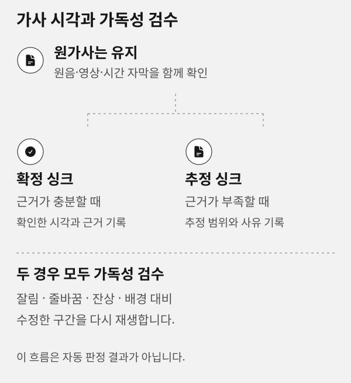

# 문제 해결

## 이 페이지의 역할

이 문서는 제작실, 완성 결과, 결과 검수에서 자주 만나는 상태를 구분하고 다음 행동을 안내합니다. 원음·가사·기존 결과를 지우거나 자동으로 바꾸는 복구는 하지 않습니다.


이 도식은 어느 화면에서 확인할지를 보여 주는 예시입니다. 예시 곡·파일·상태는 현재 프로젝트의 진단 결과가 아닙니다.

## 화면이 여러 번 열려요

> [!WARNING]
> Road Music은 기존 제작실 탭 하나를 재사용해야 합니다. 같은 주소가 열려 있으면 다시 열거나 새로고침하지 않습니다. 여러 창이 보이면 새 요청을 더 실행하지 말고 현재 프로젝트와 원음이 맞는 탭 하나를 기준으로 사용하세요. 자동화에서는 `ROADMUSIC_STUDIO_AUTO_OPEN=0`으로 창 열기를 생략할 수 있습니다.

## 선택을 저장했는데 결과가 없어요

선택 저장은 제작 요청 기록입니다. 실제 렌더가 끝나고 결과 manifest가 등록되기 전에는 [내 작업물](works.md)에 파일이 없습니다. [제작실](studio.md)에서 저장 상태를 확인하고, 해당 제작 스킬의 진행 기록을 확인하세요.

## 결과가 현재 곡과 달라요

결과의 원음 상태를 확인합니다. **다른 원음의 결과**면 현재 프로젝트의 완료본으로 승인하거나 내려받지 마세요. 목록 응답에서 받은 현재 곡의 절대 경로를 사용해 새 결과를 등록합니다.

## 같은 제목의 곡이 하나로 합쳐졌다고 보여요

내 작업물은 제목이 아니라 원음 SHA-256으로 그룹을 나눕니다. 같은 제목이라도 파일 내용이 다르면 다른 그룹이어야 합니다. `sourceMusicSha256`이 실제 원음과 다르면 다른 그룹에 섞지 않고 결과 등록을 건너뜁니다.

## 가사·자막이 없거나 다르게 보여요

원가사는 `lyrics`, SRT 같은 자막은 `captions`에 따로 등록합니다. 음성 인식 결과가 원가사와 다르더라도 원가사를 임의로 바꾸지 않습니다. 필요한 경우 [결과 검수](review.md)에 구간과 사유를 남기고 원문·싱크를 따로 판단하세요.

## 가사가 화면에서 읽기 어려워요

JIZURA 또는 제작 설정에서 글리치, 장식, 질감, 배경 전환을 낮추고 대비와 줄바꿈을 우선합니다. 추정 싱크는 확정 싱크와 분리해 기록하고, 수정한 뒤 실제 결과 영상으로 다시 검수합니다.



## 복사해 쓸 문제 확인 요청 예시

```prompt
현재 프로젝트의 원음 상태, 등록된 완성 파일, 가사·자막·스토리보드 상태를 확인해 주세요.
파일 누락·변경·다른 원음 연결·가사 가독성 문제를 구분해 원인을 기록하고, 기존 원음·원가사·완성 파일을 바꾸지 않는 복구 순서를 제안해 주세요.
추정 싱크가 있으면 확정 싱크와 별도로 남겨 주세요.
```

## 새 결과가 보이지 않아요

현재 프로젝트에서는 결과 등록 후 **새 결과 확인**을 누릅니다. 프로젝트의 manifest는 결과 목록 전체를 교체하므로 유지할 파일을 빠뜨리지 마세요. 음악별 보관함은 이미 등록한 이력은 유지하며, 새 결과를 기존 이력에 덧붙입니다.

## 다운로드가 실패해요

목록에 실제로 등록된 항목인지 확인합니다. 다운로드는 임의 경로가 아니라 결과 목록의 파일만 허용합니다. 토큰이 만료되었거나 서버가 종료됐다면 같은 프로젝트의 제작실을 다시 열고 목록을 갱신하세요.

## 음악 그룹 ZIP을 만들 수 없어요

보관함은 사용한 원음과 등록된 결과 파일이 모두 존재하고 변경되지 않았을 때만 ZIP을 만듭니다. 누락되거나 내용이 달라진 파일이 있으면 일부 파일만 담은 ZIP을 제공하지 않습니다. 파일 상태를 복구한 뒤 해당 프로젝트 결과를 다시 등록하세요.

> [!CAUTION]
> 누락·변경된 파일이 있는 그룹은 부분 ZIP으로 우회하지 않습니다. 원본 파일과 등록 경로를 확인한 뒤 실제 결과를 다시 등록합니다.

## 검수 상태를 잘못 골랐어요

**초안**, **수정 요청**, **승인** 중 올바른 상태로 바꾸고 피드백을 다시 저장합니다. 승인은 외부 게시나 렌더 재시작이 아니라 현재 등록 파일의 검수 기록입니다.

## 자주 묻는 질문

### 원가사 없이 자막만 있을 수 있나요

가능하지만 원문 검수 근거가 부족할 수 있습니다. 화면은 등록된 파일만 표시하며, 원가사가 없다는 사실을 숨기지 않습니다.

### 손상된 음원을 올리면 기존 프로젝트가 바뀌나요

아닙니다. 파일 검증에 실패하면 기존 원음과 프로젝트 상태를 유지하고 오류 원인과 다시 시도할 방법을 안내합니다.

### 브라우저가 Markdown 복사를 막아요

가이드의 원문 보기에서 내용을 직접 선택해 복사하세요. 클립보드 권한 실패는 가이드 내용을 바꾸지 않습니다.

## 다음으로 읽기

[처음부터 시작하기](start.md) · [내 작업물 확인](works.md) · [CLI 파일 등록](cli.md)
