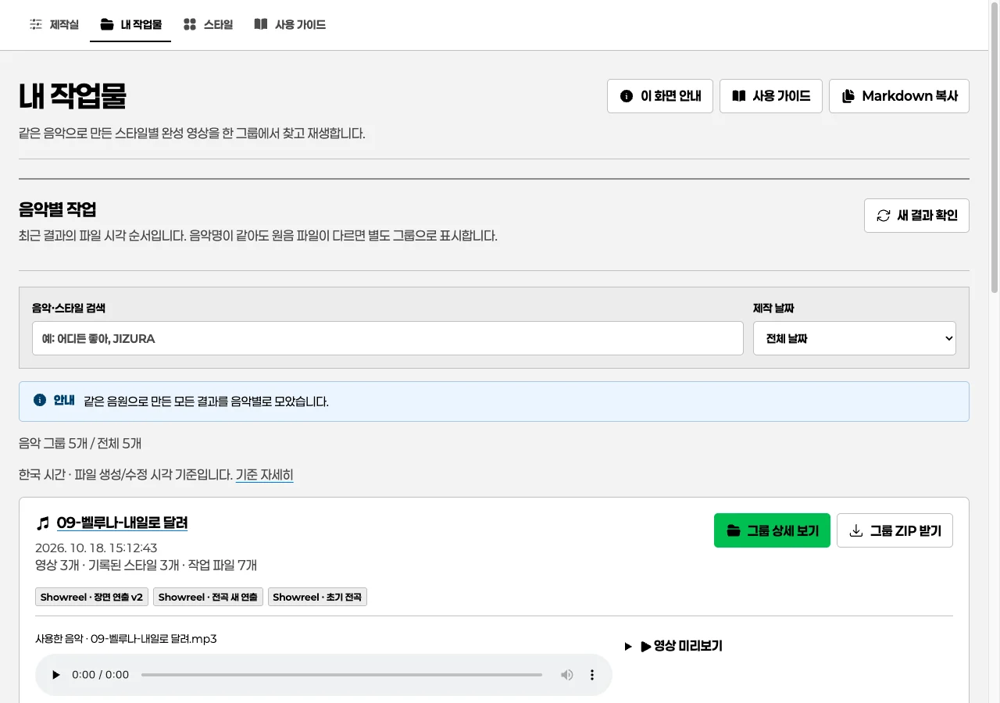
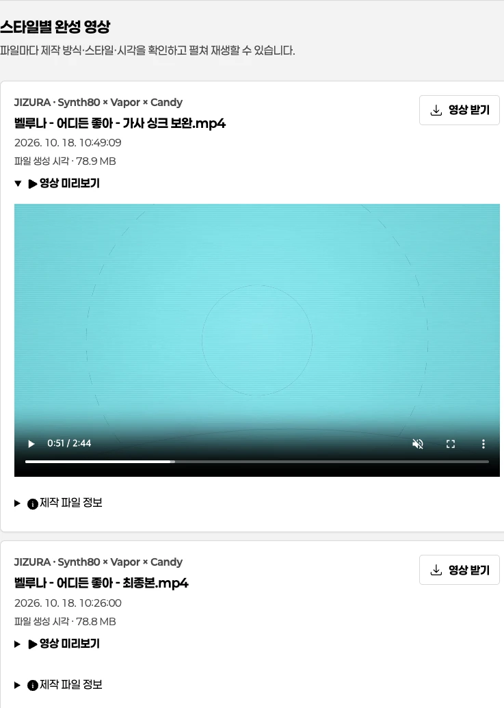
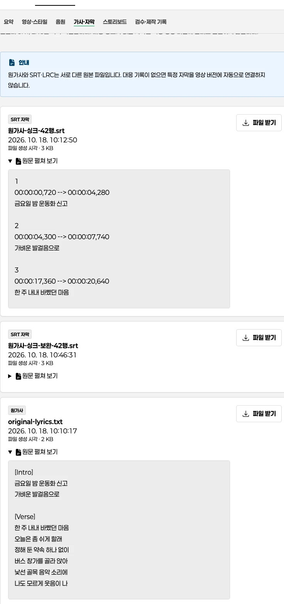
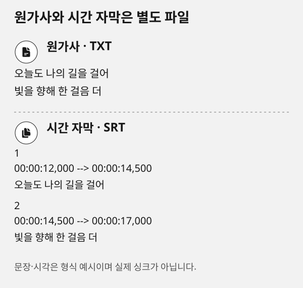
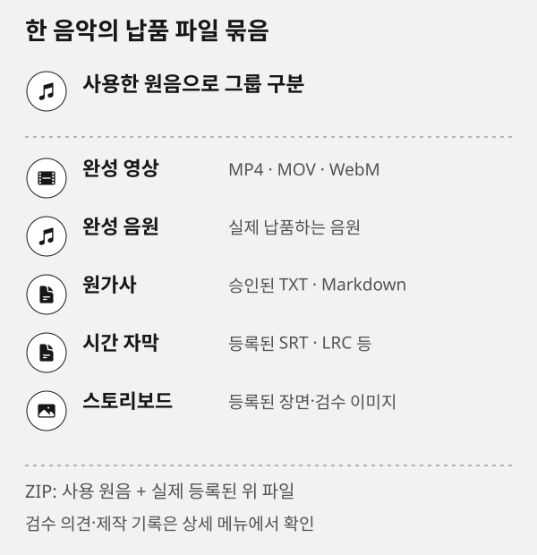

# 내 작업물: 음악별 목록과 상세

## 이 페이지의 역할

**내 작업물**은 여러 프로젝트의 완성 결과를 음악별로 모아 보는 보관함입니다. 제작 설정은 제작실에서 하고, 제작 뒤 생긴 결과·가사·자막·스토리보드·검수와 제작 기록은 이곳에서 확인합니다. 목록에서 음악을 찾고 **그룹 상세 보기**로 이동하면 같은 원음으로 만든 모든 스타일과 버전을 확인할 수 있습니다.

## 음악 그룹 기준

입력 음악의 SHA-256이 같으면 프로젝트와 파일 이름이 달라도 한 그룹으로 묶습니다. 제목이 같아도 파일 내용이 다르면 별도 그룹입니다. 다른 인코딩이나 편집본은 자동으로 같은 곡이라고 추정하지 않습니다. manifest에 적은 `sourceMusicSha256`이 실제 사용한 원음과 다르면 다른 음악 그룹에 억지로 섞지 않고 그 결과 등록을 건너뜁니다. 동일한 종류와 내용의 완성 파일은 중복 표시하지 않습니다.

> [!NOTE]
> 곡 제목이 아니라 원음 SHA-256이 그룹 기준입니다. 다른 원음의 결과나 근거가 없는 연결은 현재 곡의 완료본으로 취급하지 않습니다.

그룹 이름은 사용한 음악의 파일명에서 가져옵니다. 파일명과 스타일 설명을 함께 확인하세요. 스타일을 기록하지 않은 예전 결과는 제작 방식과 **세부 스타일 미기록**을 표시하며 임의로 스타일을 판정하지 않습니다.

## 목록에서 찾기



목록 화면의 곡명·날짜·파일 개수는 사용법을 설명하기 위한 예시입니다. 각 행은 같은 원음 해시로 묶인 작업이며, 실제 현재 곡의 완료 상태는 행의 파일 상태와 상세 화면에서 확인합니다.

1. 상단 메뉴의 **내 작업물**을 엽니다.
2. 음악 이름이나 스타일을 검색합니다.
3. 날짜는 기본 **전체 날짜**이며, **오늘** 또는 특정 제작일을 선택할 수 있습니다. 날짜는 한국 시간으로 표시합니다. **오늘**에는 그룹의 완성 파일 중 하나라도 오늘 날짜인 파일이 있는 그룹이 나타납니다.
4. 행에서 음원을 재생하거나 영상 미리보기를 펼쳐 간단히 확인합니다.
5. 모든 버전을 비교하려면 **그룹 상세 보기**를 누릅니다.

> [!NOTE]
> 목록은 최근 결과의 파일 시각 순서로 정렬합니다. 한국 시간의 연월일시분초와 시각의 근거를 함께 표시합니다. 예전 파일에는 제작 완료 기록이 없을 수 있으므로 **파일 생성 시각**, 생성 시각을 제공하지 않는 환경에서는 **파일 수정 시각**을 근거로 표시합니다. 이 파일 시각은 렌더 완료를 보장하지 않으며, 보관함 등록 시각을 제작 시각으로 바꾸지 않습니다.

## 상세에서 비교하기


각 상세 메뉴는 하나의 역할만 담당합니다. 영상과 음원을 재생한 뒤 가사·자막·스토리보드·검수 기록을 같은 음악 안에서 대조하세요.

음악 상세 주소는 `/works/원음-SHA-256/` 형식입니다. 상단에서 사용한 원음을 재생하고 그룹 전체 ZIP을 받을 수 있습니다. 상세의 내부 메뉴는 다음 순서로 이동합니다.

- **요약**: 원음, 그룹 이름, 원음 SHA-256, 최신 파일 시각과 파일 상태를 확인합니다.
- **영상 스타일**: 스타일명·스타일 ID·제작 방식·파일명·시각을 구분해 모든 완성 영상을 비교합니다.
- **음원**: 등록된 완성 음원을 재생하고 내려받습니다. 사용한 원음과 완성 음원을 혼동하지 않습니다.
- **가사·자막**: 원가사 원문과 SRT, VTT, ASS, LRC 미리보기를 별도로 확인하고 각각 내려받습니다.
- **스토리보드**: 등록된 장면 이미지를 재생·확대·다운로드해 영상과 대조합니다.
- **검수·제작 기록**: 프로젝트별 피드백, 초안·수정 요청·승인 상태, 선택·제작 근거를 확인하고 피드백을 저장합니다.
- **버전·변경 이력**: 같은 프로젝트의 완성 파일 버전과 기록된 차이를 비교합니다.
- **제작 변경 이력**: 음악·가사·제목·게시·정리의 최소 변경 이벤트를 확인합니다.
- **제작 기록**: 이 음악의 최초·수정 프롬프트, AI 응답과 결과, 작업·파일을 조회하고 원문을 복사합니다.
- **버전·변경 내역**: 같은 프로젝트의 완성본을 초 단위 제작 시각으로 비교하고, 기록된 수정 사유와 파일·텍스트·설정 diff를 확인합니다.

### 버전과 변경 내역

완성본을 다시 게시하면 새 파일과 바로 전 같은 프로젝트 버전의 해시를 비교합니다. **버전·변경 내역**에서는 `YYYYMMDD-HHMMSS` 시각, 기록된 수정 사유, 추가·삭제·변경된 파일과 가사·설정의 차이를 확인할 수 있습니다. 같은 내용이면 중복 버전을 만들지 않습니다.

버전 기록은 메타데이터 SQLite에만 저장됩니다. 과거 결과에 수정 이유가 없으면 추측하지 않고 **수정 사유 미기록**으로 표시합니다. 현재 프로젝트가 다른 음악 그룹의 버전과 비교되는 일은 없습니다.

### 영상 스타일 비교



1. **영상 스타일** 메뉴에서 제작 방식·스타일명·파일명·시각을 함께 확인합니다.
2. 영상을 하나 재생한 뒤 다른 버전을 재생하면 앞선 재생은 멈춥니다.
3. 스타일 기록이 없는 예전 파일은 이름을 추정하지 않고 **세부 스타일 미기록**으로 판단합니다.

### 원가사와 자막을 따로 확인하기





1. **가사·자막** 메뉴에서 원가사 원문과 SRT·VTT·ASS·LRC를 각각 확인하고 내려받습니다.
2. 원가사는 승인된 원문이며, 시간 정보가 있는 자막과 내용이 다르더라도 자동으로 교체하지 않습니다.
3. 어느 자막이 어느 영상 버전과 대응하는 기록이 없으면 관계를 추정하지 않고 검수 기록을 함께 봅니다.

한 파일을 재생하면 다른 재생은 일시정지됩니다. 특정 자막이 어느 영상 버전과 정확히 대응하는지 기록이 없으면 임의로 대응시키지 않습니다. 공통 화면은 확정·추정 싱크를 자동 판정하지 않으며, 제작 단계의 검수 기록과 함께 판단합니다.

개별 다운로드는 원본 파일을 그대로 제공합니다. 감상용 그룹 ZIP은 **사용한 원음과 등록된 완성 영상·완성 음원·원가사·자막·스토리보드**를 함께 담으며 같은 파일은 한 번만 넣습니다. 다른 곡의 스타일 샘플, 중간 렌더, 등록하지 않은 파일은 넣지 않습니다. ZIP 안에서 같은 파일명이 겹치면 구분 가능한 이름을 붙입니다.

native 프로젝트, direction·analysis·plan·validation·cue·compose·report 같은 제작자료는 감상용 ZIP과 분리된 **제작자료 ZIP**에서 확인합니다. 등록되지 않은 폴더나 실행 파일을 임의로 ZIP에 넣지 않습니다.



도식은 어떤 등록 파일이 음악 그룹에서 함께 전달되는지 설명합니다. 원음은 그룹을 식별하기 위해 포함되지만 완성 음원으로 표시하지 않으며, 등록되지 않았거나 누락·변경된 파일은 ZIP에 넣지 않습니다.

그룹 안의 등록 파일을 모두 찾고 내용이 등록 당시와 일치할 때만 ZIP을 만듭니다. 하나라도 누락되거나 바뀌면 일부만 담긴 ZIP을 완성본처럼 만들지 않고, 문제 파일을 먼저 안내합니다.

> [!CAUTION]
> 음악 그룹 ZIP은 등록된 원음과 완료 파일이 모두 확인될 때만 제공합니다. 누락·변경된 파일을 빼고 부분 ZIP을 완료본처럼 내려받을 수는 없습니다.

프로젝트 가사와 자막은 각각 등록된 근거입니다. 특정 자막이 어느 영상 버전과 정확히 대응하는지 기록이 없으면 임의로 대응시키지 않습니다.

## 새 결과와 예전 결과 등록

앞으로 공통 제작실에서 `publish`로 결과를 등록하면 검증된 완성 파일만 Output의 음악·프로젝트·시간 버전 폴더에 게시하고 보관함에도 자동 등록합니다. 제작 중 렌더·캐시·재개 자료는 Output에 남기지 않습니다. 프로젝트의 결과 목록이 바뀌어도 이미 보관함에 등록한 완성 파일 기록은 유지합니다.

기존 프로젝트는 공통 제작실 helper로 등록합니다. 아래 경로를 실제 설치 위치와 기존 프로젝트의 절대 경로로 바꿉니다. [CLI 가이드](cli.md)에서 단계별 사용법을 확인하세요.

```bash
STUDIO_SKILL="/absolute/skills/road-music-video-studio"
python3 "$STUDIO_SKILL/scripts/studio.py" library-register --project /absolute/existing-project
```

임의 폴더의 모든 MP4를 완성본으로 취급하지 않고, 실제 완성 결과와 원음 근거를 확인한 파일만 등록합니다. 새로 등록한 결과는 **내 작업물 새로 고침**으로 불러옵니다.

## 비교와 다운로드를 요청하는 예시

```prompt
이 음악 그룹의 모든 완성 영상을 스타일과 제작 시각별로 비교해 주세요.
각 영상의 원음 상태, 등록된 원가사·자막·스토리보드 유무를 확인하고, 누락되거나 변경된 파일은 완료본으로 표시하지 말아 주세요.
다운로드 전에는 음악 그룹 ZIP에 사용 원음과 등록된 완성 파일만 포함되는지 확인해 주세요.
```

## 목록에서 바로 할 수 있는 세 가지

1. 검색으로 곡명이나 스타일을 좁힌 뒤, 행의 음원과 접힌 영상 미리보기를 확인합니다.
2. **그룹 상세 보기**에서 내부 메뉴를 따라 버전·가사·스토리보드를 비교합니다.
3. 모든 파일 상태가 정상일 때만 개별 파일 또는 음악 그룹 ZIP을 내려받습니다.

## 오류와 복구

### 오늘 작업이 없다고 나와요

오늘은 한국 시간 기준입니다. 과거 결과가 사라진 것은 아닙니다. **전체 날짜**로 바꿔 확인하세요.

### 파일을 찾을 수 없다고 나와요

등록 후 원본을 이동하거나 삭제하면 재생·다운로드할 수 없습니다. 파일 상태를 확인한 뒤 올바른 경로의 완성 결과를 다시 등록하세요. 누락된 파일이 있는 그룹은 일부만 담긴 ZIP을 완료본처럼 제공하지 않습니다.

### 등록 후 파일 내용이 달라졌어요

수정된 파일을 예전 완성본처럼 내려받지 않도록 검증합니다. 현재 파일을 새 결과로 다시 등록한 뒤 확인하세요. 보관함은 파일의 버전을 자동 복구하지 않습니다.

## 다음으로 읽기

[제작실](studio.md) · [현재 프로젝트 호환 보기](results.md) · [결과 검수](review.md) · [CLI 등록 절차](cli.md) · [문제 해결](troubleshooting.md)

## 좋아요 음악 모아 보기

목록 또는 그룹 상세의 하트 **좋아요**를 누르면 같은 프로필의 SQLite에 저장됩니다. 목록의 **좋아요만 보기**는 좋아요 그룹만 보여 주며 검색·날짜 필터도 이 목록에 적용됩니다. 다시 누르면 전체 음악으로 돌아갑니다. 좋아요 취소는 파일을 삭제하지 않습니다. 좋아요는 보존 핀과 별개이며 그룹 전체 제거 시 연결된 좋아요 정보도 제거됩니다.

## 프롬프트와 제작 결과

그룹 상세의 **제작 기록**에서 이 음악에 연결된 메인·수정 프롬프트와 AI 응답·결과 요약, 실제 작업과 파일을 봅니다. 프롬프트를 개별 복사해 다음 작업에 참고할 수 있습니다. 버전 비교와 검수 의견은 기존 메뉴에서 계속 확인합니다. 미기록 원문은 복원된 것처럼 표시하지 않습니다.

## 기록을 찾는 빠른 경로

상세의 상단 메뉴는 **요약 · 영상·스타일 · 음원 · 가사·자막 · 스토리보드 · 제작 기록**입니다. `제작 기록`에서 최초 프롬프트·추가 요청·결과를 확인하고, 아래의 **버전 비교**, **변경 이력**, **검수·자료**를 필요할 때 펼치세요. 예전 버전 링크로 들어와도 해당 펼침이 열립니다.

프롬프트 복사 권한이 차단되면 같은 카드 아래에 원문이 선택된 복사란이 나타납니다. 직접 복사하면 되며 요청을 다시 실행하지 않습니다. 최초 요청은 메인 영역에 한 번만 표시하고 추가 요청과 구분합니다.

전체 프로젝트의 성능과 업데이트는 목록의 **전체 제작 분석·업데이트**에서, 이 음악만의 분석은 상세의 **이 음악 제작 분석**에서 확인합니다. 검색·날짜·좋아요를 바꾸면 결과 수 안내가 함께 갱신됩니다.

## 제작 시간과 과정 비중

목록의 **제작 누적 시간**은 음악 그룹에 연결된 실측 작업 시간입니다. 그룹 상세의 요약에서는 음악·영상 누적과 과정별 파이 그래프를 봅니다. 가사 수정·음원 재생성·다시 렌더한 작업도 실제 기록된 만큼 포함됩니다. 하위 단계는 다시 더하지 않고 미측정 시간은 0초로 바꾸지 않습니다. 동시에 진행한 작업도 누적하므로 실제 시작부터 끝까지의 경과 시간과 다릅니다. 다른 작업과 비교하려면 **이 음악 제작 분석 → 전체 프로젝트 비교**로 이동하세요.
